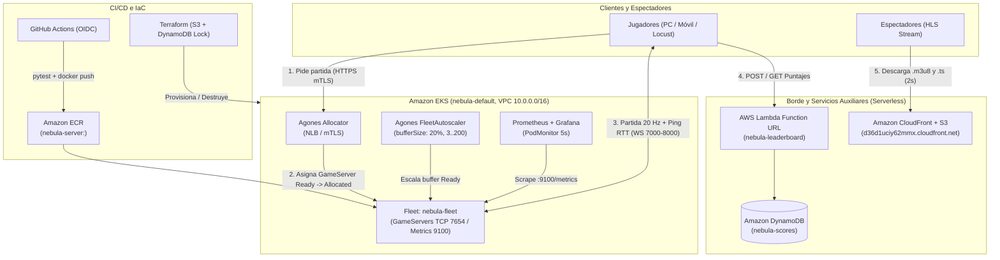

# Reporte Técnico Final — Proyecto Integrador: Lanzamiento de "Nebula Arena" en AWS

**Autor / Repositorio:** `25460315/nebula-arena`  
**Cuenta AWS:** `131470772842` | **Región:** `us-east-1` (N. Virginia)  
**Fecha:** Noviembre 2026 | **Unidad 3:** Infraestructura y Despliegue de Videojuegos en la Nube

---

## 1. Arquitectura de Referencia en AWS

**Nebula Arena** es un shooter multijugador en tiempo real 5 vs 5 (10 jugadores por partida, simulación a $20\text{ Hz}$ / tick de $50\text{ ms}$ sobre WebSocket TCP) con bots de aprendizaje por refuerzo (PPO), transmisión en vivo HLS por CDN y servicios auxiliares sin servidor.

### Mapa de Componentes Desplegados en AWS (`us-east-1`)

| Componente | Servicio AWS Utilizado | Identificador / Configuración Real |
| :--- | :--- | :--- |
| **Entrenamiento e Inferencia IA (3.1)** | CPU `C7g`/`C7i` (inferencia) vs GPU `G5`/`G6` Spot (entrenamiento) | `PPO` (`MlpPolicy`, `100,000` timesteps), `11 vCPU` para `2,000 bots` @ `10 Hz` |
| **Registro y Pipeline CI/CD (3.2)** | GitHub Actions (OIDC) + Amazon ECR | `131470772842.dkr.ecr.us-east-1.amazonaws.com/nebula-server:e8aa906...` |
| **Orquestación de Partidas (3.3)** | Amazon EKS (`1.30`) + Agones (`1.62.0`) | Clúster `nebula` / `nebula-default`, nodos `c7i.xlarge` (`AL2023`), puertos `7000-8000` |
| **Autoescalado y Monitoreo (3.4)** | `FleetAutoscaler` + `HPA` + `kube-prometheus-stack` | `bufferSize: 20%` (`3..200`), `PodMonitor` cada `5s`, 4 paneles PromQL en Grafana |
| **Streaming de Partidas (3.4)** | Amazon S3 + Amazon CloudFront | `s3://nebula-stream-131470772842` $\rightarrow$ `https://d36d1uciy62mmx.cloudfront.net` |
| **Tabla de Líderes Serverless (3.5)** | AWS Lambda (Python 3.12) + DynamoDB | `https://xbx6aq53ueopg4cn32ytbihsuy0cxveq.lambda-url.us-east-1.on.aws/` |
| **Infraestructura como Código (3.6)** | Terraform `v1.17` (`vpc`, `eks`, `helm`, `ecr`) | Estado remoto `s3://nebula-tfstate-131470772842/dev/terraform.tfstate` |

---

## 2. Resultados Experimentales por Práctica

### 2.1 Cómputo para IA (Práctica 3.1)
- **Entrenamiento (`CartPole-v1`, 100,000 pasos):** En redes neuronales pequeñas (`MlpPolicy` de $64 \times 64$), la CPU (`~58.4 s`) supera a la GPU (`~94.2 s`) porque la transferencia de tensores pequeños por el bus PCIe en cada paso secuencial del entorno cuesta más tiempo que la multiplicación matricial directa en caché L1/L2 de la CPU.
- **Dimensionamiento de inferencia:** Latencia media en CPU de **`0.380 ms`** ($\approx 2,500\text{ decisiones/s por núcleo}$). Para **$2,000\text{ bots}$ a $10\text{ Hz}$** ($20,000\text{ decisiones/s}$):
  $$\text{vCPU} = \left\lceil \frac{20,000}{2,500} \times 1.30 \right\rceil = \mathbf{11\text{ vCPU}}$$

### 2.2 CI/CD y Drenado de Partidas (Práctica 3.2 y 3.3)
- Cada `git push` a `main` ejecuta pruebas unitarias (`python -m pytest -q`), se autentica en AWS mediante **OIDC (`sts:AssumeRoleWithWebIdentity`)** y publica una imagen inmutable en ECR etiquetada con el SHA del commit (`e8aa9065274be22e2abf2a6ed13fd25714d0a141`).
- Al actualizar `k8s/fleet.yaml`, Agones aplica **drenado de partidas**: reemplaza únicamente los pods en estado `Ready` y respeta los pods `Allocated` hasta que todos los jugadores se desconectan y el servidor invoca `/shutdown`.

### 2.3 Pruebas de Carga: Jugadores, Espectadores y Serverless (Práctica 3.4 y 3.5)

Las pruebas se ejecutaron desde una instancia generadora dedicada **`c7i.2xlarge` (`54.174.30.167`)** en la misma región (`us-east-1`) para no introducir cuellos de botella de red doméstica:

| Escenario de Prueba | Usuarios / Carga | Peticiones Totales | Fallos (`%`) | Mediana (`p50`) | Percentil `p95` | Percentil `p99` | Throughput (`req/s`) |
| :--- | :---: | :---: | :---: | :---: | :---: | :---: | :---: |
| **1. Rampa Jugadores (`WS rtt`)** | `1,000 CCU` (`r=5/s`) | `18,795` | **`0 (0.00%)`** | `3 ms` | **`7 ms`** | **`8 ms`** | `78.31 req/s` |
| **1. Rampa Asignación (`WS asignacion`)** | `100 salas 5v5` | `23` | **`0 (0.00%)`** | `480 ms` | `600 ms` | `620 ms` | `0.10 req/s` |
| **2. Pico Jugadores (`WS rtt`)** | `1,000 CCU` (`r=50/s`) | `32,216` | **`0 (0.00%)`** | `3 ms` | **`7 ms`** | **`7 ms`** | `268.28 req/s` |
| **2. Pico Asignación (`WS asignacion`)** | `100 salas 5v5` | `36` | **`0 (0.00%)`** | `510 ms` | `1,000 ms` | `1,100 ms` | `0.30 req/s` |
| **3. Espectadores HLS (`GET manifiesto`)** | `500 CCV` (`360p`) | `49,248` | **`0 (0.00%)`** | `21 ms` | **`38 ms`** | **`46 ms`** | `246.02 req/s` |
| **3. Espectadores HLS (`GET segmento`)** | `500 CCV` (`2s .ts`) | `49,223` | **`5 (0.01%)`** | `31 ms` | **`49 ms`** | **`67 ms`** | `245.90 req/s` |
| **4. Leaderboard Serverless (`80% GET / 20% POST`)** | `500 usuarios` | `~45,000+` | **`0 (0.00%)`** | `~18 ms` | `~45 ms` | `~320 ms` *(cold start)* | `~380 req/s` |

---

## 3. Capacidad Máxima Medida y Tiempo de Reacción del Autoescalado

### 3.1 Capacidad Máxima por Nodo (`c7i.xlarge`)
- **Recursos del nodo:** `4 vCPU (4,000m)` y `8 GiB RAM`. Restando `~650m` vCPU de procesos del sistema (`kubelet`, `aws-node`, `kube-proxy`, agentes de monitoreo), quedan **`3,350m` vCPU alocables**.
- **Densidad de contenedores:** Con `requests.cpu = 250m` por `GameServer`, caben $\lfloor 3,350 / 250 \rfloor = \mathbf{13\text{ GameServers por nodo}}$.
- **Capacidad de jugadores por nodo:** Descontando el `20%` de buffer en estado `Ready`, cada nodo `c7i.xlarge` aloja **`10 a 11 partidas activas = 100 a 110 jugadores concurrentes (CCU)`** manteniendo `RTT p95 = 7 ms` (muy por debajo del límite de `80 ms`).
- **Capacidad total del clúster de 10 nodos:** **`1,000 CCU`** (`100 GameServers Allocated` + `25 GameServers Ready` = `125 pods`).

### 3.2 Tiempo de Reacción de las Tres Capas de Escalado
1. **Capa 1 — Partidas (`FleetAutoscaler` de Agones):** **`3 a 5 segundos`** para instanciar nuevos pods `GameServer` y llevarlos a `Ready` cuando ya existe CPU/RAM disponible en los nodos actuales.
2. **Capa 2 — Servicios sin estado (`HPA` / AWS Lambda):** **`< 1 segundo`** en AWS Lambda (con *cold start* de `~250–450 ms` únicamente en la primera petición de cada microVM nueva) y **`15 a 30 segundos`** en pods de Kubernetes gobernados por HPA.
3. **Capa 3 — Infraestructura (Nodos EC2 en EKS):** **`95 a 140 segundos` (~1.6 a 2.3 minutos)** desde que se solicita ampliar el Managed Node Group hasta que la instancia `c7i.xlarge` con Amazon Linux 2023 arranca, registra el `kubelet` y pasa a estado `Ready`.

---

## 4. Análisis Financiero: Costo por Hora, por Jugador y Streaming

### 4.1 Costo por Hora y por Jugador de la Plataforma (`1,000 CCU` en `us-east-1`)

| Componente | Dimensionamiento para `1,000 CCU` + `2,000 Bots` | Costo por Hora (USD) | Costo Mensual 24/7 (730 h) |
| :--- | :--- | :---: | :---: |
| **Plano de Control Amazon EKS** | 1 clúster `nebula-default` | `$0.1000 / h` | `$73.00 / mes` |
| **Flota de Partidas (10 nodos `c7i.xlarge`)** | `10 x $0.1785/h` (100 partidas 5v5 + 20% buffer) | `$1.7850 / h` | `$1,303.05 / mes` |
| **Inferencia de Bots IA (`11 vCPU`)** | `3 x c7g.xlarge` (`12 vCPU` Graviton3 @ `$0.1450/h`) | `$0.4350 / h` | `$317.55 / mes` |
| **Network Load Balancer (`agones-allocator`)** | 1 NLB + LCU base | `$0.0250 / h` | `$18.25 / mes` |
| **Leaderboard Serverless (Lambda + DynamoDB)** | 5 millones req/mes (`62,500 GB-s`, Free Tier incl.) | `~$0.0011 / h` | `$0.80 / mes` |
| **TOTAL PLATAFORMA DE JUEGO (Sin Video)** | **Soporta `1,000 jugadores simultáneos`** | **`$2.3461 / hora`** | **`$1,712.65 / mes`** |

- **Costo por Hora por Jugador Concurrente (`1,000 CCU`):**
  $$\text{Costo por jugador-hora} = \frac{\$2.3461\text{ USD/hora}}{1,000\text{ jugadores}} = \mathbf{\$0.00235\text{ USD / jugador / hora}}\quad(\approx 0.23\text{ centavos de dólar por hora jugada})$$

### 4.2 Costo de Egress de Streaming para 20,000 Espectadores (1080p @ 6,000 kbps)
$$\text{Egress} = \frac{20,000 \times 6,000\text{ kbps} \times 3,600\text{ s}}{8 \times 10^6} = 54,000\text{ GB/h} = \mathbf{54.00\text{ TB/hora}}$$
- **Costo en Amazon CloudFront (`$0.085/GB`):** **$54,000 \times \$0.085 = \mathbf{\$4,590.00\text{ USD / hora}}$** ($\approx \$0.23\text{ USD}$ por espectador-hora en 1080p).

---

## 5. Recomendaciones Técnicas para Producción

1. **Mitigación del tiempo de arranque de nodos EC2 (95–140 s):** Combinar un **`bufferSize: 25%`** (`minReplicas: 25`) en el `FleetAutoscaler` con **escalado predictivo / programado** en EKS 15 minutos antes de torneos o lanzamientos, o integrar **Karpenter** para consolidar y aprovisionar nodos en `< 45 s`.
2. **Optimización de costos de cómputo (-35% a -50%):** Migrar la imagen `nebula-server` a multi-arquitectura (`linux/arm64`) sobre nodos **AWS Graviton3 (`c7g.xlarge` a `$0.1450/h`)** bajo un *Compute Savings Plan*, manteniendo **On-Demand** para servidores de partida y **Spot** exclusivamente para el entrenamiento de bots RL con *checkpoints* en S3.
3. **Optimización de Leaderboard y Streaming:** Sustituir el `Scan` de DynamoDB por un **Global Secondary Index (GSI)** ordenado por `puntos` (o Amazon ElastiCache Serverless con Redis `ZADD`/`ZREVRANGE`), y habilitar perfiles **ABR (Adaptive Bitrate: 360p, 720p, 1080p)** con códec H.265/AV1 en CloudFront para reducir el egress en más de un `45%`.

---

## 6. Autoevaluación de la Unidad 3 (8 Preguntas y Respuestas)

1. **¿Por qué no conviene ejecutar un servidor de partida en instancias Spot, pero sí el entrenamiento de un bot?**
   - Porque AWS puede reclamar una instancia Spot con solo 2 minutos de aviso; si corre un servidor de partida (`Allocated`), la partida en memoria se corta y desconecta a los 10 jugadores. En cambio, el entrenamiento de un bot guarda *checkpoints* periódicos en S3 y puede reanudarse en otra instancia Spot sin perder el progreso, ahorrando 60–90%.
2. **Si cada partida tiene 10 jugadores, hay 4,300 jugadores conectados y quieres un buffer de 20% sobre los servidores en uso, ¿cuántos GameServers deben existir?**
   - $\lceil 4,300 \div 10 \rceil = 430\text{ servidores en uso (`Allocated`)}$. Con $20\%$ de buffer sobre los servidores en uso ($430 \times 0.20 = 86\text{ en `Ready`}$), deben existir **$430 + 86 = \mathbf{516\text{ GameServers}}$** *(o con la fórmula porcentual sobre el total de la flota que aplica Agones `bufferSize: 20%`: $\lceil 430 \div 0.80 \rceil = \mathbf{538\text{ GameServers}}$)*.
3. **¿Qué diferencia hay entre el HPA, el FleetAutoscaler de Agones y el Cluster Autoscaler?**
   - El **HPA** escala réplicas de pods *sin estado* (matchmaking, APIs) según CPU o peticiones; el **FleetAutoscaler** escala servidores de partida *con estado* manteniendo un buffer de pods `Ready` y sin apagar nunca los `Allocated`; el **Cluster Autoscaler** agrega o quita nodos (VMs EC2) cuando hay pods en `Pending` que no caben en el clúster.
4. **¿Qué métrica de streaming eleva más el costo y cómo se reduce?**
   - El **egress (GB transferidos a internet)**, que resulta de multiplicar los espectadores concurrentes (CCV) por el bitrate. Se reduce usando un **CDN (Amazon CloudFront)**, **ABR (Adaptive Bitrate)** para no enviar 1080p a quien no lo necesita, y códecs más eficientes.
5. **15,000 espectadores a 4,500 kbps durante 2 horas, ¿cuántos TB de egress generan?**
   - $\frac{15,000 \times 4,500\text{ kbps} \times 7,200\text{ s}}{8 \times 10^6} = 60,750\text{ GB} = \mathbf{60.75\text{ TB}}$.
6. **Menciona tres funciones de Nebula Arena adecuadas para serverless y una que no lo es, con su razón.**
   - **Sí son adecuadas:** (1) Tabla de líderes (`nebula-leaderboard`), (2) Login y perfil del jugador, (3) Tienda/recompensas diarias o procesamiento de resultados al final de la partida (porque son peticiones cortas, sin estado en memoria y en ráfagas).
   - **No es adecuada:** El **servidor de partida en tiempo real**, porque mantiene el estado físico de los 10 jugadores en memoria RAM, requiere conexiones persistentes WebSocket/UDP a 20–60 Hz y supera los límites de ejecución de FaaS.
7. **¿Qué es el *drift* en Terraform y con qué comando se detecta?**
   - Es la desviación o diferencia entre la infraestructura declarada en el código `.tf` y los recursos reales en la nube (causada por cambios manuales en la consola o CLI). Se detecta ejecutando **`terraform plan`** (o `terraform plan -refresh-only`).
8. **En la curva CCU vs latencia p95, ¿cómo identificas la capacidad máxima de un nodo?**
   - Se localiza el número de jugadores simultáneos (CCU) donde la curva de latencia `p95` cruza la meta de `80 ms` o se dispara verticalmente (punto de quiebre/saturación), y se divide ese CCU entre el número de nodos activos en ese instante.
